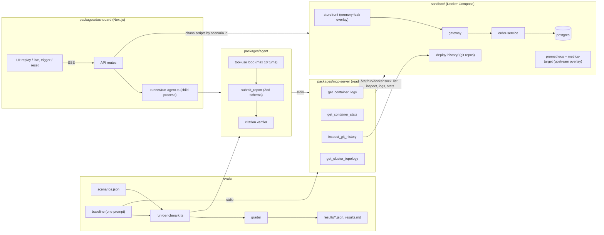

# IncidentLens

IncidentLens is an agent that diagnoses failures in a small Docker sandbox and writes a root-cause report
whose every evidence quote is checked against the tool output it actually saw. It reads logs, container stats,
deploy history and topology through four read-only MCP tools, and it chooses which tools to call and with which
arguments. It is benchmarked against a naive baseline that gets the same telemetry, from the same tools, all at
once in a single prompt.

## Quick look (no API key)

The dashboard replays saved runs without calling the API:

```bash
cd packages/dashboard
npm install
npm run dev          # http://127.0.0.1:3000
```

Pick a replay, watch the event stream, and open the citations in the final report. Running real agents needs
the sandbox and an API key; see [Run it](#run-it).

## Architecture



Every tool output is capped at 4000 characters per call. The baseline collects every container's logs (tail=1000),
every container's stats, the topology and every commit of every deploy history, then makes one model call.

## Citation verifier

`packages/agent/src/verifier.ts`

- The verifier records the exact text of every tool result shown to the model during a run.
- When the agent calls `submit_report`, each evidence `verbatim_quote` must be a literal, case-sensitive substring
  of at least one non-error tool result from that run, and at least 12 characters long.
- If any quote fails, the report is rejected with an `is_error` tool result naming the bad quotes, and the agent
  can try again within its remaining turns.
- The free-text `source` field is not enforced. If a quote is found, but not in the call its `source` names, it is
  only flagged.

This means the agent's citation validity is 100% by construction: a report that fails verification is never
accepted. Baseline quotes are checked the same way after the fact.

## Benchmark results

N=5 per scenario and approach, model `claude-sonnet-5-5`. Full per-run tables, including every root cause
text: [`evals/results.md`](evals/results.md); raw data: `evals/results/*.json`.

| Scenario | Source | Agent | Baseline | Agent tokens (mean) | Baseline tokens (mean) | Ratio | Agent time | Baseline time | Agent turns |
|---|---|---|---|---|---|---|---|---|---|
| db-pool-exhaustion | self-written | 4/5 | 5/5 | 49,971 | 10,712 | 4.7x | 34.5s | 9.2s | 6.6 |
| memory-leak-oom | self-written | 5/5 | 5/5 | 47,387 | 14,897 | 3.2x | 21.8s | 12.7s | 6.0 |
| corrupt-deploy | self-written | 5/5 | 5/5 | 20,530 | 14,379 | 1.4x | 11.1s | 10.2s | 4.0 |
| prometheus-bad-scrape-crash | upstream | 5/5 | 5/5 | 36,158 | 15,522 | 2.3x | 18.0s | 12.1s | 4.8 |
| **total** | | **19/20** | **20/20** | | | | | | |

Tokens are input + output. The first three scenarios were run on 2026-10-28, the Prometheus scenario on
2026-10-29. The failed agent run in db-pool-exhaustion stopped with `stop_reason=max_tokens`.

**Upstream scenario.** Prometheus v3.10.0 (`prom/prometheus:v3.10.0`) panics in its text parser when a
scrape target serves a malformed metrics line, and the process crash-loops. This is
[prometheus#18225](https://github.com/prometheus/prometheus/issues/18225), fixed upstream in
[3b44b8b](https://github.com/prometheus/prometheus/commit/3b44b8b463be9291a5605b935a5fbeda88db1366).
My only addition is `metrics-target`, an nginx container that serves the bad line to trigger it.

## Findings and limits

- **The baseline matched the agent on accuracy at lower cost.** All telemetry in these sandboxes fits in one
  prompt, so choosing tools gives no advantage here, and the agent used about 1.4x to 4.7x the baseline's tokens.
  Not tested: telemetry larger than fits in one prompt, which is where an agent should pay off.
- **Scenarios:** 3 are self-written, 1 is an upstream bug (above). The self-written ones were designed by the same
  person who wrote the agent, so they are not a general result.
- **Grading is a keyword heuristic** (`evals/scenarios.json` → `grading`): a run is correct if every keyword group
  matches, with whole-word negation. I read every root cause by hand as well.
- **The `oom` grading group of memory-leak-oom was widened** after run 1 of an earlier session (commit 83e8315).
  All reported runs were graded with the widened group, for agent and baseline alike.
- **OOM is only inferable in memory-leak-oom.** Docker clears OOMKilled/ExitCode when the restart policy restarts
  the container, so the tools show the OOM only indirectly (restart count, uptime, memory vs. limit, repeated
  startup lines).
- **The 4000-char cap truncated some baseline inputs** (e.g. postgres logs); results.md lists which per scenario.
- **max_tokens:** one agent run hit `max_tokens`. Afterwards a per-turn trace and one retry per turn were added to
  both agent and baseline. The three self-written scenarios were measured before that, without retry; the
  Prometheus scenario was measured with it, and no run needed a retry.
- **PgBouncer bug ([#1023](https://github.com/pgbouncer/pgbouncer/issues/1023)) was evaluated and dropped:**
  reproducing it needed a custom client and a metrics sidecar from me, so it would not have been an independent test.
- **"Thinking off" means `between_tools`.** On Claude Sonnet 5.5 this is the lowest thinking setting, not literally
  no thinking. Other models fall back to their default thinking (`packages/agent/src/agent.ts`).

## Dashboard

`packages/dashboard`: a Next.js app over the same agent and scenarios. Both modes use one event schema, streamed
over SSE.

- **Replay (default, free):** streams events from a saved file in `packages/dashboard/replays/`.
  - `*.reconstructed.ndjson` (one per scenario) are rebuilt from the stored benchmark results, agent run 1. They
    contain no agent text. Three of them hold only the report and its verification; the Prometheus one also has
    the tool calls (from the per-turn trace), without the tool results.
  - `replays/live/prometheus-bad-scrape-crash-20261029-025450.ndjson` is the one real recording of a live run, with
    agent text, tool calls and tool results.
- **Live:** runs the real agent. Off unless the server is started with `ALLOW_LIVE=true`, and limited to one run
  start per minute. Every live run is saved as a new replay in `replays/live/`.
- **Trigger / reset buttons** run a scenario's chaos and reset scripts from `evals/scenarios.json`, by scenario id.

Security:

- **Allow-list:** only scenario ids from `scenarios.json` can be triggered, and their scripts must be plain file
  names in `sandbox/chaos/`; anything else is refused.
- **Loopback only:** the server binds to 127.0.0.1, every API request must use a loopback Host (against DNS
  rebinding), and POSTs must carry the dashboard's own Origin (against cross-site requests).
- **Live gate:** live runs return 403 unless `ALLOW_LIVE=true`, and are rate-limited to one start per minute.
- **Separate processes:** the agent runs in its own child process (`runner/run-agent.ts`), the only child that gets
  the full environment. Chaos scripts run with secret-looking variables and `ALLOW_LIVE` removed from their
  environment, and their output is redacted.

## Run it

Requires Docker, Node.js and npm. There is no root `package.json`; each package is installed on its own.

```bash
# Sandbox: start from a clean state (regenerates the deploy history, starts the base services, checks GET /orders)
./sandbox/chaos/reset.sh

# Trigger one scenario (reset.sh between scenarios)
./sandbox/chaos/scenario-db-exhaustion.sh
./sandbox/chaos/scenario-memory-leak.sh
./sandbox/chaos/scenario-corrupt-deploy.sh
./sandbox/chaos/scenario-prometheus-bad-scrape.sh

# Agent CLI (needs ANTHROPIC_API_KEY in the environment or in packages/agent/.env)
(cd packages/mcp-server && npm install)
cd packages/agent && npm install
npm start                                       # default alert: gateway 504s on /orders
npm start -- "users report checkout hanging"   # custom alert

# Evals (from evals/)
npm install
npm test                                        # grader, scenario, retry and event tests; no API calls
npm run check -- --scenario <id>                # check a scenario's precondition only
npm run bench -- --scenario <id> --runs <N>     # agent + baseline, uses API credit

# Dashboard (from packages/dashboard/)
npm install
npm test
npm run dev                                     # replay only
ALLOW_LIVE=true npm run dev                     # enables live runs (uses API credit)
```

## Status / not done

- **Phase 7 (extended thinking, measured):** deferred for cost.
- **Phase 8 (prompt caching, measured):** planned, after Phase 11.
- **Phase 9 (RAG experiment):** deferred.
- **Phase 11 (Docker packaging):** not done. There is no `docker-compose.demo.yml` and no one-command startup.
- **Docker socket:** the MCP server talks to `/var/run/docker.sock` directly, which is effectively root access to
  the host. "Read-only" is enforced only by the server's own code (`packages/mcp-server/src/docker.ts` calls only
  list, inspect, logs and stats). A `docker-socket-proxy` in front of the socket is planned for Phase 11 and has
  not been added.

## Repo layout

```
sandbox/            Docker Compose: gateway, order-service, postgres; overlays for storefront and prometheus
  chaos/            trigger and reset scripts per scenario
  deploy-history/   generator and patches; output in .deploy-history/ (gitignored)
packages/
  mcp-server/       read-only telemetry tools (logs, stats, git history, topology)
  agent/            tool loop, Zod report schema, citation verifier
  dashboard/        Next.js UI, SSE, replay/live runner, saved replays
evals/              baseline, grader, scenarios.json, benchmark runner, results/
```

The sandbox bugs (the pool leak at `/orders/leaky`, the idempotency cache without eviction, the break patch in
`sandbox/deploy-history/patches/break/`) are deliberate.
